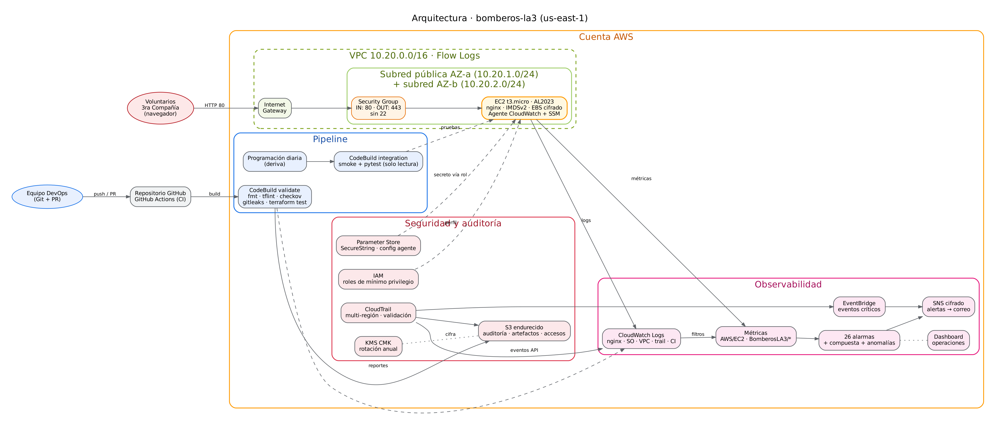
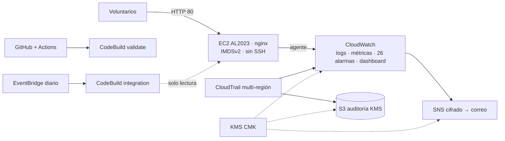
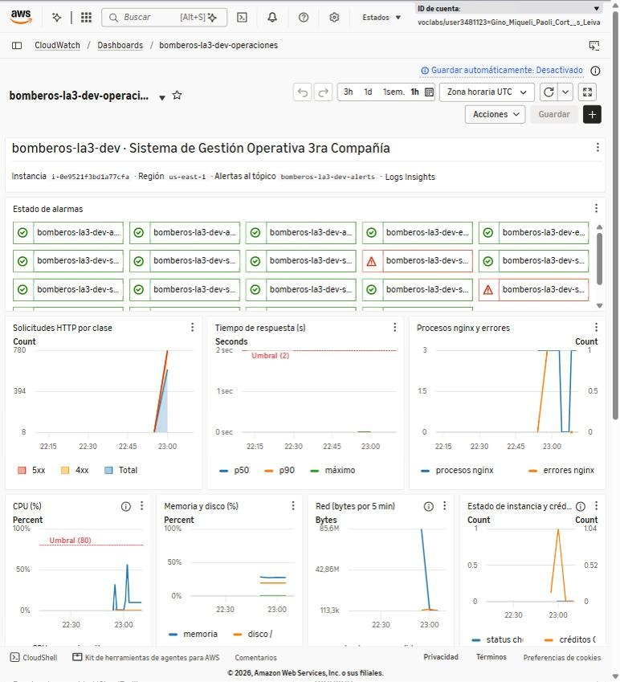
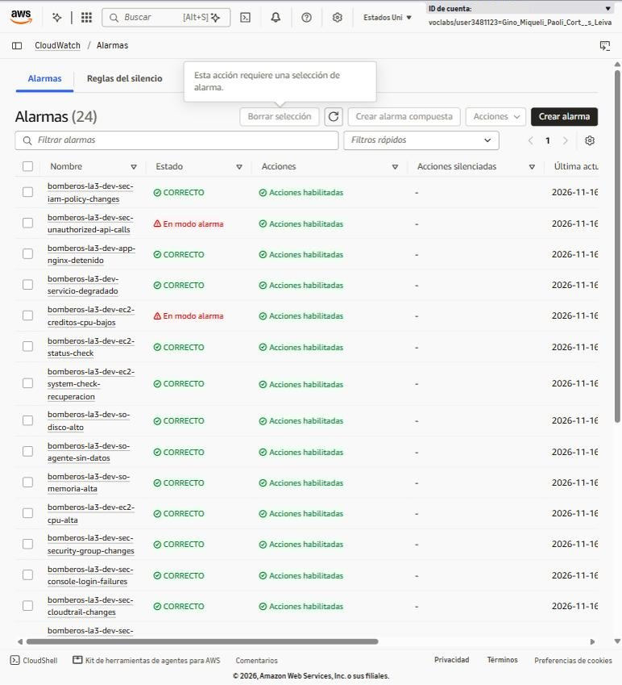
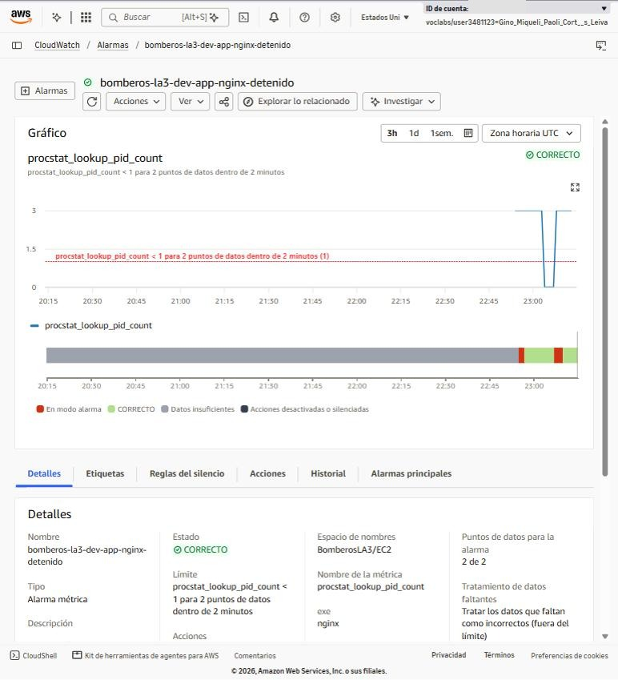
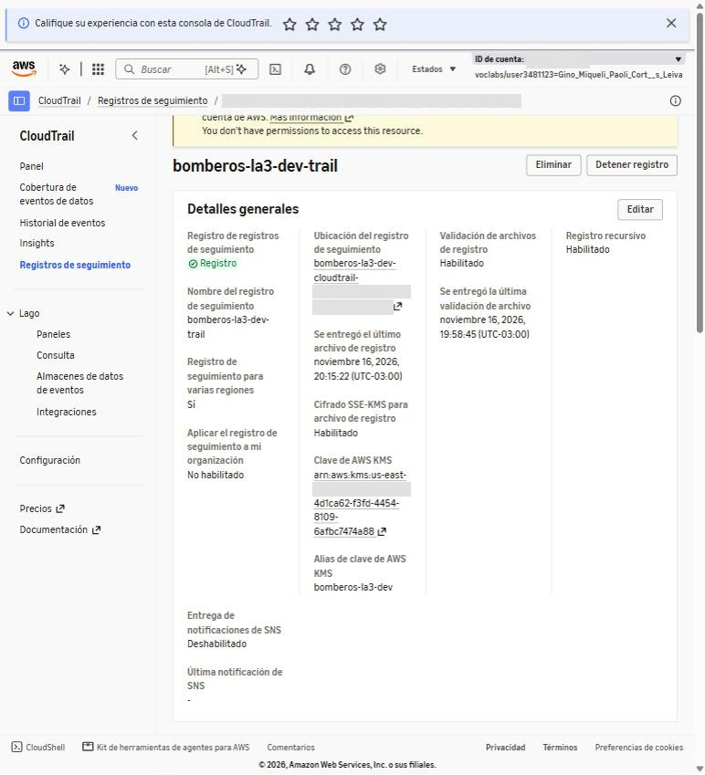
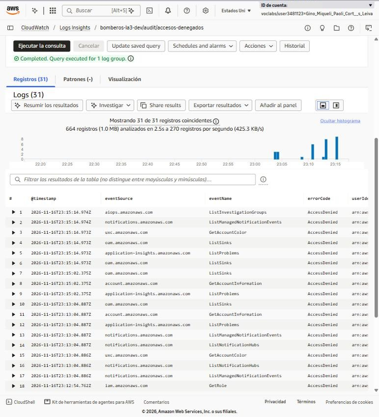
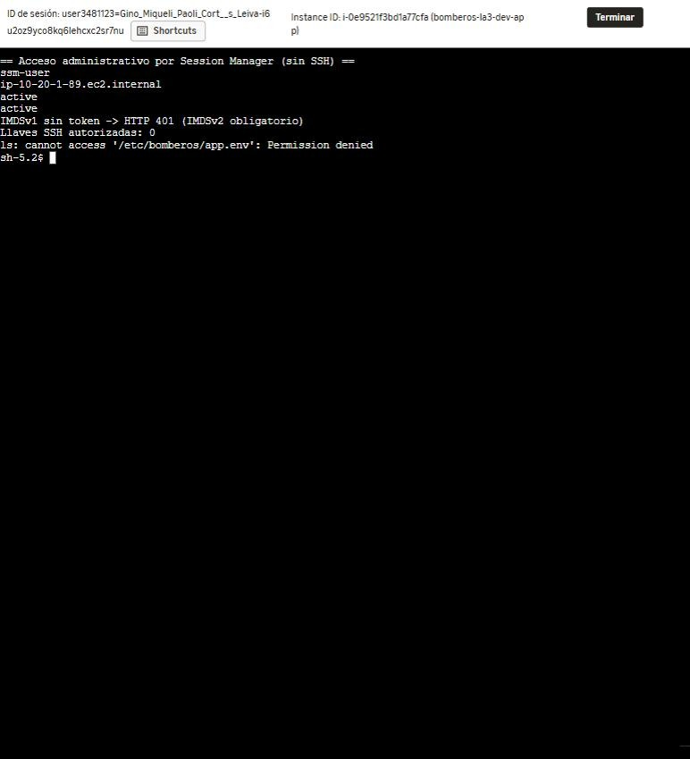
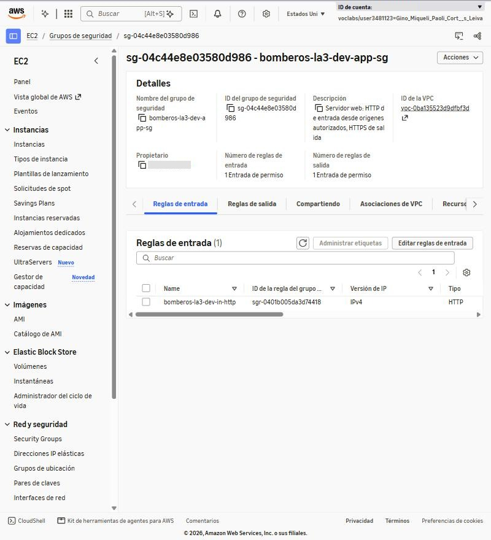

# bomberos-la3 · Gestión de la configuración en AWS con Terraform

[](https://github.com/Firefigther69/bomberos-iac/actions/workflows/ci.yml)

Infraestructura como código para la **plataforma web de gestión operativa de la 3ra Compañía del Cuerpo de Bomberos de Los Ángeles**. Incluye monitoreo y logging con detección temprana de incidentes, auditoría completa de la cuenta, pruebas automatizadas integradas en un pipeline DevOps y controles de seguridad de mínimo privilegio.

| | |
|---|---|
| **Institución** | INACAP Sede Los Ángeles · Área TI y Ciberseguridad |
| **Evaluación** | Evaluación sumativa · Infraestructura como código en ambientes Cloud |
| **Herramienta IaC** | Terraform ≥ 1.11 · AWS provider 5.x |
| **Región** | `us-east-1` |
| **Recursos** | 123 |

## Contenido

1. [Caso de estudio](#1-caso-de-estudio)
2. [Objetivos](#2-objetivos)
3. [Arquitectura](#3-arquitectura)
4. [Servicios AWS utilizados](#4-servicios-aws-utilizados)
5. [Estructura del repositorio](#5-estructura-del-repositorio)
6. [Requisitos previos](#6-requisitos-previos)
7. [Instalación y despliegue](#7-instalación-y-despliegue)
8. [Pruebas](#8-pruebas)
9. [Monitoreo](#9-monitoreo)
10. [Logging y auditoría](#10-logging-y-auditoría)
11. [Seguridad](#11-seguridad)
12. [Evidencias](#12-evidencias)
13. [Autor](#13-autor)
14. [Reflexión final](#14-reflexión-final)

Documentación detallada en [`docs/`](docs/):
[Informe técnico (Word)](docs/Informe-Tecnico-bomberos-la3.docx) · [Requerimientos](docs/01-requerimientos.md) · [Arquitectura y decisiones](docs/02-arquitectura.md) · [Matriz de trazabilidad](docs/03-matriz-trazabilidad.md) · [Controles de seguridad](docs/04-controles-seguridad.md) · [Despliegue y evidencias](docs/05-despliegue-y-evidencias.md)

---

## 1. Caso de estudio

La 3ra Compañía registra asistencias, emergencias, voluntarios y estado del material mayor en planillas y mensajería. La información queda dispersa, sin respaldo y sin registro de cambios. El proyecto despliega en AWS una plataforma web para esa gestión. La infraestructura se declara como código para que sea **reproducible**, **observable** (la directiva recibe una alerta cuando algo falla), **auditada** (cada acción en la cuenta queda registrada) y **segura** (sin puertos administrativos, secretos cifrados y permisos mínimos).

## 2. Objetivos

**General.** Implementar un sistema de gestión de la configuración en AWS, mediante Terraform y prácticas DevOps, que despliegue la plataforma de la compañía con monitoreo, pruebas automatizadas y seguridad por defecto.

**Específicos**
1. Declarar toda la infraestructura en código versionado, validado y reproducible (RF-02).
2. Recolectar métricas y logs del host, la aplicación, la red y el pipeline, con alarmas que detecten incidentes en 10 minutos o menos (RF-03, RF-04, RNF-02).
3. Registrar y alertar toda acción administrativa sobre la cuenta (RF-05, RS-07).
4. Validar cada cambio con pruebas automatizadas y verificar a diario la infraestructura real (RF-06).
5. Aplicar mínimo privilegio, protección de credenciales y restricción de accesos (RS-01 a RS-09).

## 3. Arquitectura





Las decisiones de diseño (ADR-01 a ADR-10), el flujo DevOps y el costo estimado están en [docs/02-arquitectura.md](docs/02-arquitectura.md).

## 4. Servicios AWS utilizados

| Servicio | Uso en el proyecto | Por qué se eligió | Requerimientos |
|---|---|---|---|
| Amazon VPC | Red aislada en 2 AZ, IGW, tablas de rutas, SG por defecto bloqueado, Flow Logs | Aísla el sistema de la compañía y permite registrar todo el tráfico de red | RS-04, RF-04 |
| Amazon EC2 | Servidor web Amazon Linux 2023 (t3.micro), recuperación automática | Control total del servidor y del agente de monitoreo a bajo costo (capa gratuita) | RF-01, RNF-01, RNF-04 |
| AWS IAM | Roles por función con políticas de mínimo privilegio, perfil de instancia, política de contraseñas | Servicio nativo para identidades y permisos; evita llaves de acceso en el servidor | RS-01, RS-03 |
| AWS KMS | CMK con rotación anual para EBS, logs, S3, SNS, SSM y CodeBuild | Una sola llave administrada y auditada cifra todos los datos sensibles | RS-05 |
| AWS Systems Manager | Parameter Store (secreto y configuración del agente), Session Manager | Guarda secretos cifrados fuera del código y reemplaza SSH con sesiones auditadas | RS-06, RF-07 |
| Amazon S3 | Buckets endurecidos para auditoría, artefactos y registros de acceso | Almacenamiento durable y barato para la evidencia de auditoría | RF-05, RNF-05 |
| Amazon CloudWatch | Logs, agente, métricas, filtros, Logs Insights, 26 alarmas, dashboard, detección de anomalías | Centraliza métricas y logs y alerta sin instalar herramientas adicionales | RF-03, RF-04, RNF-02, RNF-03 |
| Amazon SNS | Notificación cifrada de incidentes | Avisa por correo a los voluntarios sin un servidor de mensajería propio | RF-05, RNF-02 |
| AWS CloudTrail | Auditoría multi-región con validación de integridad | Registra quién hizo qué y cuándo en la cuenta, con prueba de no alteración | RF-05, RS-07 |
| Amazon EventBridge | Alertas en tiempo real y ejecución programada de pruebas | Reacciona a eventos de seguridad en segundos y automatiza verificaciones | RS-07, RF-06 |
| AWS CodeBuild | Pipeline de validación y pruebas de integración con reportes JUnit | Ejecuta las pruebas dentro de AWS con un rol acotado y sin llaves | RF-06, RS-09 |

## 5. Estructura del repositorio

```text
.
├── main.tf                    Índice del módulo raíz
├── versions.tf / providers.tf Versiones fijadas y etiquetas por defecto
├── variables.tf / locals.tf   Entradas validadas y nomenclatura
├── network.tf                 VPC, subredes, IGW, rutas, Flow Logs
├── security_groups.tf         Reglas de red de la aplicación
├── kms.tf                     CMK y política de llave
├── iam.tf                     Roles y políticas de mínimo privilegio
├── secrets.tf                 Parameter Store (SecureString)
├── s3.tf                      Buckets (usa modules/secure_bucket)
├── compute.tf                 Instancia EC2
├── logging.tf                 Logs, agente CloudWatch, filtros, consultas
├── alarms.tf                  Alarmas operativas y alarma compuesta
├── audit.tf                   CloudTrail, alarmas CIS, EventBridge
├── dashboard.tf / sns.tf      Dashboard y canal de alertas
├── cicd.tf                    Proyectos CodeBuild y programación
├── outputs.tf
├── modules/secure_bucket/     Módulo de bucket S3 endurecido
├── app/index.html             Contenido web
├── scripts/                   user data, deploy, destroy, smoke test, simulación de incidentes,
│                              recolección de evidencias, verificación de trazabilidad
├── buildspec/                 validate.yml · integration.yml
├── tests/                     *.tftest.hcl (unitarias) · mocks/ · static/ · integration/ (pytest)
├── policies/checkov/          Estándares de seguridad propios (CKV2_BOMB_1–6)
├── .github/workflows/ci.yml   Integración continua en GitHub
├── .pre-commit-config.yaml    Controles locales antes de cada commit
├── .tflint.hcl / .checkov.yaml
├── terraform.tfvars.example / backend.hcl.example
└── docs/                      Informe (Word), requerimientos, arquitectura, matriz de
                               trazabilidad, controles de seguridad y evidencias
```

## 6. Requisitos previos

| Herramienta | Versión | Uso |
|---|---|---|
| Terraform | ≥ 1.11 (probado con 1.12.2) | Despliegue y pruebas unitarias |
| AWS CLI | v2 | Autenticación, SSM, simulaciones |
| Python | ≥ 3.10 | Pruebas de integración, Checkov |
| Git | — | Control de versiones |
| Opcionales | TFLint 0.55, Checkov 3.2, gitleaks 8.21, pre-commit | Validación local |

**Cuenta AWS**
- **Cuenta propia:** identidad con permisos para crear los recursos (idealmente un rol de despliegue con sesión temporal; nunca la cuenta raíz).
- **AWS Academy Learner Lab:** copiar las credenciales temporales de *AWS Details* a `~/.aws/credentials` y usar `use_lab_role = true`.

> Las credenciales **nunca** se escriben en archivos del proyecto. Terraform las toma del entorno (`aws configure`, perfil SSO o variables `AWS_*`).

## 7. Instalación y despliegue

```bash
git clone https://github.com/Firefigther69/bomberos-iac.git
cd bomberos-iac
cp terraform.tfvars.example terraform.tfvars   # editar: correo, use_lab_role, repository_url
aws sts get-caller-identity                     # confirmar la cuenta antes de desplegar
```

### Terraform Init

```bash
terraform init                                   # estado local (laboratorio)
# o con estado remoto seguro:
cp backend.hcl.example backend.hcl               # editar bucket
terraform init -backend-config=backend.hcl       # requiere backend "s3" {} en versions.tf
```

### Terraform Plan

```bash
terraform fmt -check -recursive && terraform validate
terraform test                                   # 24 pruebas unitarias sin costo
terraform plan -out=tfplan                       # revisar: 123 recursos a crear
```

### Terraform Apply

```bash
terraform apply tfplan
terraform output -json > outputs.json
./scripts/smoke_test.sh
```

Después del `apply`: **confirmar la suscripción SNS** desde el correo indicado en `alarm_email`. El script `./scripts/deploy.sh` encadena todos los pasos anteriores con confirmación explícita.

### Terraform Destroy

```bash
./scripts/destroy.sh            # pide escribir el nombre del ambiente
# equivalente: terraform destroy
```

Con `force_destroy_buckets = false` los buckets con registros no se eliminan, por diseño (protección de evidencia).

### Ajustes para AWS Academy Learner Lab

| Síntoma | Ajuste en `terraform.tfvars` |
|---|---|
| `iam:CreateRole` denegado | `use_lab_role = true` |
| CodeBuild no puede asumir `LabRole` | `enable_codebuild = false` (validación en GitHub Actions; integración con `deploy.sh`) |
| `s3:GetBucketObjectLockConfiguration` denegado por SCP al leer buckets | Automático con `use_lab_role = true`: el contenedor del bucket se crea con CloudFormation desde Terraform |
| VPC Flow Logs no puede usar `LabRole` | Automático con `use_lab_role = true`: los Flow Logs se entregan a S3 |
| Error al asociar el rol de CloudTrail a CloudWatch Logs | `cloudtrail_to_cloudwatch = false` |
| Acción `ec2:recover` no permitida en la alarma | `enable_auto_recovery = false` |

## 8. Pruebas

| Nivel | Comando | Resultado |
|---|---|---|
| Formato / sintaxis | `terraform fmt -check -recursive && terraform validate` | OK |
| Lint | `tflint --init && tflint --recursive` | 0 problemas |
| Secretos | `gitleaks detect --source .` | sin hallazgos |
| Políticas de seguridad | `checkov --config-file .checkov.yaml` | 347 aprobados, 0 fallidos |
| Unitarias (mock, sin AWS) | `terraform test` | 24 aprobados |
| Estáticas del repositorio | `pytest tests/static` | 21 aprobados |
| Trazabilidad requerimiento → prueba | `python3 scripts/check_traceability.py` | 29/29 requerimientos cubiertos |
| Humo (post-despliegue) | `./scripts/smoke_test.sh` | 8 verificaciones |
| Integración (post-despliegue) | `pip install -r tests/integration/requirements.txt && pytest tests/integration -v` | 25 pruebas |

**Pipeline**

```text
commit ─► pre-commit ─► push/PR ─► GitHub Actions + CodeBuild validate (webhook) ─► merge ─► deploy.sh ─► CodeBuild integration
                                                         │                                              ▲
                                                         └── reportes JUnit + alarma/SNS si falla        └── EventBridge diario (deriva)
```

Disparo automático de `validate` en cada push/PR: conectar GitHub en la consola de CodeBuild y usar `enable_github_webhook = true`. `scripts/deploy.sh` ejecuta `integration` al terminar el despliegue y falla si las pruebas no pasan.

```bash
aws codebuild start-build --project-name bomberos-la3-dev-validate
aws codebuild start-build --project-name bomberos-la3-dev-integration
```

Cada prueba está vinculada a un requerimiento: `scripts/check_traceability.py` lo verifica en cada ejecución del pipeline y falla si alguno queda sin prueba. Ver también la [matriz de trazabilidad](docs/03-matriz-trazabilidad.md).

## 9. Monitoreo

- **Dashboard:** `terraform output dashboard_url`. Muestra estado de alarmas, solicitudes HTTP, latencia, nginx, CPU, memoria, disco, red, eventos de seguridad y pipeline.
- **Métricas:** `AWS/EC2` (1 min), `BomberosLA3/EC2` (agente: memoria, disco, swap, E/S, TCP, procesos), `BomberosLA3/App` (desde logs), `BomberosLA3/Security` (desde CloudTrail).
- **26 alarmas** notifican a SNS, entre ellas CPU, créditos, *status checks* con recuperación automática, memoria, disco, latido del agente, nginx detenido, 5xx, latencia p90, anomalías de red, fallos del pipeline, 10 de seguridad y la compuesta `servicio-degradado`.
- **Probar la detección:** `./scripts/simulate_incidents.sh {cpu|nginx|trafico|denegado|sns}`.

La justificación de cada métrica (componente, métrica, por qué es relevante y cómo detecta temprano) está en el [informe técnico](docs/Informe-Tecnico-bomberos-la3.docx), sección III.5.

## 10. Logging y auditoría

| Grupo de logs | Fuente |
|---|---|
| `/bomberos-la3/dev/app/nginx-access` | Accesos HTTP en JSON |
| `/bomberos-la3/dev/app/nginx-error` | Errores de nginx |
| `/bomberos-la3/dev/system/messages` · `/system/secure` | Sistema operativo y autenticación/sudo |
| `/bomberos-la3/dev/system/cloudwatch-agent` | Estado del agente |
| `/bomberos-la3/dev/network/vpc-flow-logs` | Tráfico de la VPC |
| `/bomberos-la3/dev/audit/cloudtrail` | Eventos de la API de AWS |
| `/bomberos-la3/dev/cicd/codebuild` | Ejecuciones del pipeline |

Todos los grupos están cifrados con la CMK y se retienen 365 días. Hay cinco consultas guardadas en Logs Insights (`bomberos-la3-dev/…`). CloudTrail es multi-región, valida la integridad de sus archivos, está cifrado y entrega a S3 y CloudWatch Logs.

## 11. Seguridad

| Control | Implementación |
|---|---|
| Mínimo privilegio | Un rol por función; permisos limitados a ARN del proyecto; condiciones por *namespace* y servicio; sesiones ≤ 1 h |
| Credenciales | Sin llaves estáticas (roles y OIDC); secreto en SecureString + CMK; gitleaks en pre-commit y CI |
| Accesos | Sin SSH (Session Manager); entrada 80 / salida 443; SG por defecto vacío; S3 privado |
| Cifrado | CMK con rotación; TLS obligatorio (≥ 1.2 en S3) |
| Endurecimiento | IMDSv2, parches automáticos, nginx sin versión, cabeceras OWASP, solo GET/HEAD |
| Política como código | Checkov + 6 estándares propios; 18 excepciones justificadas en línea |
| Trazabilidad | CloudTrail, 10 alarmas CIS, EventBridge, Flow Logs, registro de accesos S3, etiquetas por recurso |

Administración sin SSH:

```bash
aws ssm start-session --target "$(terraform output -raw instance_id)"
```

## 12. Evidencias

Despliegue real del 16-11-2026 en AWS Academy Learner Lab. El resumen, los incidentes simulados y la relación de cada evidencia con los requerimientos están en [docs/05-despliegue-y-evidencias.md](docs/05-despliegue-y-evidencias.md).

| Evidencia | Archivo en `docs/evidencias/` |
|---|---|
| Aplicación y prueba de humo (8/8) | `capturas/E01-aplicacion.jpg`, `plataforma/92-prueba-de-humo.txt` |
| Dashboard y métricas | `capturas/E05-dashboard.jpg`, `capturas/E05b-dashboard-seguridad.jpg`, `plataforma/graficos/` |
| Logs centralizados | `capturas/E08-grupos-de-logs.jpg`, `plataforma/10-grupos-de-logs.txt` |
| Alarmas y detección de incidente | `capturas/E06-alarmas.jpg`, `capturas/E12-incidente-nginx.jpg`, `capturas/E12b-historial-sns.jpg`, `capturas/E13-correos-alerta.png` |
| Auditoría (CloudTrail e integridad) | `capturas/E10-cloudtrail.jpg`, `capturas/E10b-cloudtrail-eventos.jpg`, `capturas/E19-accesos-denegados.jpg`, `plataforma/32-integridad-logs.txt` |
| Pipeline y pruebas automatizadas | `pipeline-local/`, `plataforma/93-pruebas-integracion.txt` (25/25) |
| Seguridad | `capturas/E17-session-manager.jpg`, `capturas/E17b-security-group.jpg`, `capturas/E20-s3-cifrado-etiquetas.jpg` |
| Video narrado del entorno en funcionamiento (4 min 57 s) | `video-evidencia.mp4` |

### Capturas principales

**Dashboard de operación**



**Alarmas con notificación SNS**



**Incidente simulado: nginx detenido, detectado y recuperado**



**CloudTrail multi-región con validación de integridad**



**Accesos denegados detectados en Logs Insights**



**Administración sin SSH con Session Manager**



**Grupo de seguridad con una sola regla de entrada**



El número de cuenta y los datos personales están enmascarados en todas las evidencias.

## 13. Autor

| Autor | Responsabilidad |
|---|---|
| Gino Cortés Leiva | Trabajo individual: arquitectura, seguridad, observabilidad, automatización, pruebas, despliegue y documentación |

**Asignatura:** DevOps · **Sección:** 2026/P TILE23/AOL-ELE-TILE23-C2/V Virtual ELE · **Docente:** Roberto Antonio Fica Domke

El historial de commits registra el desarrollo del proyecto (ver [CONTRIBUTING.md](CONTRIBUTING.md)).

## 14. Reflexión final

**Aprendizajes.** Escribir pruebas antes de desplegar cambió mi forma de trabajar. Las pruebas unitarias con proveedor simulado detectaron un error que habría hecho fallar el primer despliegue, y las políticas propias detectaron roles sin límite de duración de sesión. El control automático de trazabilidad mostró que un tercio de los requerimientos no tenía prueba aunque la matriz manual parecía completa: la correspondencia entre pruebas y requerimientos debe verificarse con código, no solo documentarse. También comprendí que monitorear es decidir qué preguntas se quieren responder durante un incidente; por eso cada alarma referencia el requerimiento que protege.

**Dificultades.** La principal fue conciliar el mínimo privilegio con AWS Academy, que no permite crear roles; se resolvió con un diseño dual (`use_lab_role`) que mantiene los roles dedicados para cuentas reales. El despliegue real reveló además tres restricciones que las pruebas simuladas no podían anticipar (lectura de buckets por Terraform, CodeBuild y VPC Flow Logs con `LabRole`), que se resolvieron en código.

**Aporte a la operación, la seguridad y la automatización.** Para una organización de voluntarios sin personal técnico permanente, la solución reemplaza la vigilancia manual por alertas automáticas y la configuración manual por código revisable. Cada cambio queda registrado con autor y fecha, en Git para la configuración y en CloudTrail para las acciones en la cuenta, y un entorno idéntico puede levantarse en minutos si el actual se pierde.
