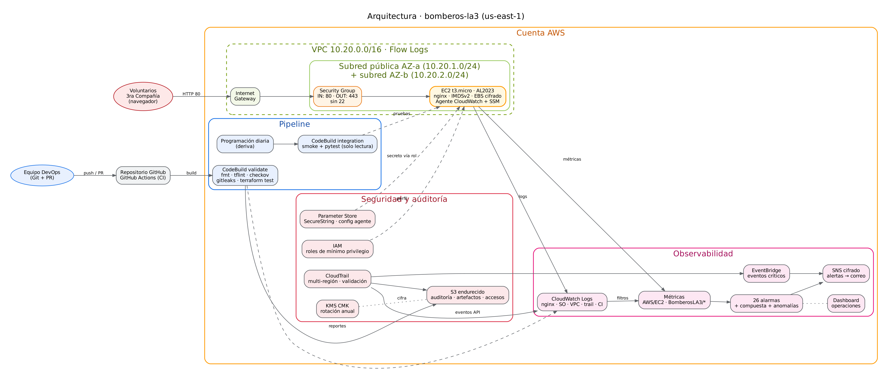
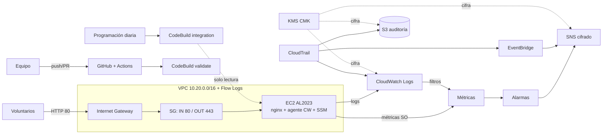
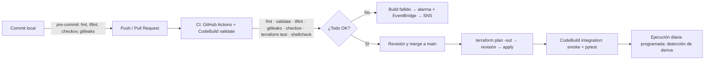

# Diseño de la solución

> Fuente editable del diagrama: `docs/img/arquitectura.dot` (Graphviz). Regenerar con `dot -Tpng -Gdpi=170 docs/img/arquitectura.dot -o docs/img/arquitectura.png`.

## 1. Vista por capas

| Capa | Servicios | Archivo |
|---|---|---|
| Red | VPC, 2 subredes en 2 AZ, IGW, tabla de rutas, SG por defecto bloqueado, VPC Flow Logs | `network.tf`, `security_groups.tf` |
| Cómputo | EC2 t3.micro, Amazon Linux 2023, nginx | `compute.tf`, `scripts/user_data.sh.tftpl`, `app/` |
| Identidad | Roles IAM por función, perfil de instancia, política de contraseñas | `iam.tf` |
| Datos y secretos | KMS CMK, Parameter Store SecureString, S3 endurecido (módulo propio) | `kms.tf`, `secrets.tf`, `s3.tf`, `modules/secure_bucket/` |
| Observabilidad | CloudWatch Logs, agente, filtros de métricas, consultas guardadas, alarmas, dashboard, SNS | `logging.tf`, `alarms.tf`, `dashboard.tf`, `sns.tf` |
| Auditoría | CloudTrail, alarmas CIS, EventBridge | `audit.tf` |
| Automatización | CodeBuild (validate, integration), EventBridge programado, GitHub Actions, pre-commit | `cicd.tf`, `buildspec/`, `.github/workflows/`, `.pre-commit-config.yaml` |

## 2. Flujo DevOps

## 3. Decisiones de arquitectura (ADR)

| ID | Decisión | Alternativas evaluadas | Justificación |
|---|---|---|---|
| ADR-01 | Terraform como herramienta de IaC | CloudFormation, CDK | Plan explícito antes de aplicar, pruebas nativas (`terraform test`) con proveedor simulado, ecosistema de análisis (TFLint, Checkov) y portabilidad del conocimiento. |
| ADR-02 | Instancia única en subred pública, sin puertos administrativos | ALB + subred privada + NAT | Un NAT Gateway (~USD 33/mes) y un ALB (~USD 17/mes) duplican el costo del laboratorio. El riesgo se mitiga con SG de entrada solo 80, salida solo 443, sin SSH, IMDSv2 y recuperación automática. La evolución a ALB+HTTPS queda documentada como mejora. |
| ADR-03 | Session Manager en vez de SSH | Bastion host, llaves SSH | Sin puertos abiertos ni llaves que custodiar; cada sesión queda en CloudTrail. |
| ADR-04 | Una CMK propia para todo el proyecto | Llaves administradas por AWS | Permite rotación controlada, condicionar el uso por servicio y auditar cada operación de cifrado. Una sola llave simplifica la operación en un proyecto pequeño. |
| ADR-05 | Configuración del agente CloudWatch en Parameter Store | Archivo embebido en user data | Se modifica sin recrear la instancia y queda versionada en Terraform. |
| ADR-06 | Logs de nginx en formato JSON | Formato combinado | Permite filtros de métricas por campo (`$.status`, `$.request_time`) sin expresiones regulares frágiles. |
| ADR-07 | Filtros de métricas sobre CloudTrail + EventBridge | Solo uno de los dos | Los filtros generan métricas históricas y umbrales; EventBridge notifica en segundos con el detalle del evento. |
| ADR-08 | Dos etapas de pruebas: unitarias con proveedor simulado y de integración de solo lectura | Solo pruebas post-despliegue | Las unitarias corren sin credenciales en cada commit (rápidas, sin costo); las de integración verifican el estado real y detectan deriva. |
| ADR-09 | Compatibilidad con Learner Lab mediante `use_lab_role` | Proyecto solo para cuenta propia | La cuenta académica prohíbe crear roles IAM; la variable permite desplegar sin romper el diseño de mínimo privilegio en cuentas reales. |
| ADR-10 | Módulo local `secure_bucket` | Repetir la configuración por bucket | Garantiza que los tres buckets compartan exactamente los mismos controles. |

## 4. Costo estimado (us-east-1, uso continuo)

| Componente | USD/mes aprox. |
|---|---|
| EC2 t3.micro + EBS gp3 10 GiB | 8,4 |
| Monitoreo detallado EC2 + métricas propias (~25) | 9,0 |
| Alarmas (26, incluidas 2 de anomalía) | 3,5 |
| KMS CMK | 1,0 |
| CloudWatch Logs (ingesta < 2 GB) | 1,0 |
| CloudTrail (trail de administración gratuito; eventos de datos mínimos) | < 0,5 |
| CodeBuild (≈ 60 builds de 3 min, small) | 1,0 |
| **Total** | **≈ 20–25** |

Destruir el ambiente al terminar cada sesión de laboratorio (`./scripts/destroy.sh`) reduce el costo a horas efectivas de uso.
